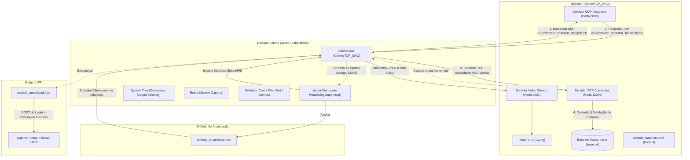
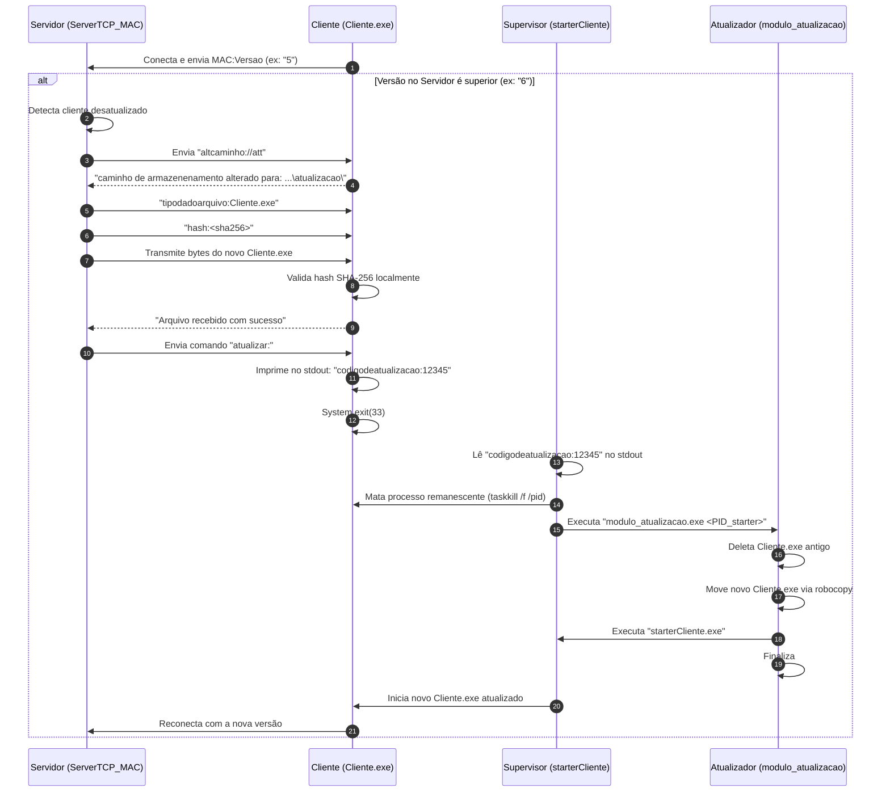

# Documentação Técnica do Ecossistema SINC_DRIVER (Server-Socket)

> **Finalidade do Documento:** Este documento descreve de ponta a ponta a arquitetura, funcionamento, protocolos de rede, fluxos de execução e papéis de cada projeto existente neste diretório. Ele foi estruturado para que qualquer desenvolvedor ou inteligência artificial compreenda plenamente o ecossistema sem a necessidade de realizar engenharia reversa ou auditoria do código-fonte.

---

## 1. Visão Geral do Sistema

O **SINC_DRIVER (Server-Socket)** é uma suíte de software distribuída em Java (compatível com Java 8/1.8+) projetada para o **gerenciamento remoto centralizado, monitoramento e controle operacional de computadores em laboratórios de informática** (com forte contexto de implantação acadêmica, ex.: laboratórios da UFPI).

### Capacidades Principais
* **Gerenciamento em Massa:** Desligamento, reinicialização, cancelamento, bloqueio de sessão e sincronização de horário via broadcast ou direcionado por máquina (MAC), bancada ou setor.
* **Descoberta Automática na Rede (Zero-Config):** Os clientes localizam o servidor via broadcast UDP sem necessidade de fixar IPs manualmente.
* **Supervisão e Persistência Ativa (Watchdog):** O cliente é protegido contra fechamento indevido; caso o processo seja finalizado sem autorização, é exigida senha de administrador ou o processo é ressuscitado imediatamente.
* **Auto-Update Transparente:** O servidor detecta clientes em versões legadas, transfere os novos binários em segundo plano com validação de hash SHA-256 e orquestra o processo de reinicialização e substituição a quente.
* **Monitoramento de Tela (Remote Desktop / Streaming):** Transmissão em tempo real de frames JPEG da tela dos computadores dos alunos/estações para um painel visual do administrador.
* **Bloqueio de Máquina e de Internet:** Bloqueio de tela fullscreen ("Acesso Negado") com supressão de atalhos do Windows, além de bloqueio de navegação web via injeção de proxy nulo no Registro do Windows.
* **Autenticação Automática em Portal Cativo:** Módulo headless/GUI para autenticar as máquinas de laboratório em portais de rede universitários com credenciais institucionais.
* **Wake-on-LAN (WoL):** Disparo de Magic Packets para ligar remotamente as máquinas do laboratório que estiverem desligadas.

---

## 2. Mapa dos Projetos na Pasta

O diretório de trabalho contém **6 módulos/projetos** complementares:

```
Server-Socket/
├── ServerCliente_13_12/          # SERVIDOR CENTRAL (Painel Swing, Servidor TCP/UDP/Vídeo)
│   └── ServerCliente/
│       └── ServerTCP_MAC/
├── starterCliente/              # SUPERVISOR / WATCHDOG (Monitor de integridade do Cliente)
├── ClienteSemMaven/             # CLIENTE (Agente operacional principal - Ant/NetBeans, versão refatorada)
├── ClienteTCP_MAC_Maven/        # CLIENTE (Versão estruturada com Maven pom.xml)
├── modulo_atualizacao/          # ATUALIZADOR INDEPENDENTE (Substituição de arquivos e hot-swap)
└── modulo_autenticador/         # AUTENTICADOR DE REDE (Bypass/Login no captive portal institucional)
```

### Resumo dos Componentes

| Projeto | Papel | Tipo | Tecnologias Chave |
| :--- | :--- | :--- | :--- |
| **`ServerTCP_MAC`** | Servidor / Painel Central de Controle | Aplicação GUI Desktop | Java Swing, Java Sockets (TCP/UDP), Datagram, MessageDigest SHA-256 |
| **`starterCliente`** | Guardião / Watchdog do Cliente | Serviço / Daemon Supervisor | ProcessBuilder, ManagementFactory, RuntimeMXBean, JOptionPane |
| **`ClienteSemMaven`** | Agente que roda nas máquinas clientes | Daemon / Tray furtivo | Java Sockets, Java Robot, SystemTray, Registro do Windows, PowerShell |
| **`ClienteTCP_MAC_Maven`**| Versão Mavenizada do Agente Cliente | Projeto Maven (JAR) | Maven, JNA 5.10, SLF4J, Logback, Jackson, Apache HttpClient |
| **`modulo_atualizacao`** | Atualizador externo de binários | Utilitário CLI/Process | ProcessBuilder, Robocopy (Windows), Taskkill |
| **`modulo_autenticador`** | Autenticador de Captive Portal | Utilitário HTTP / GUI | Apache HttpClient 4.5, SSL Trust All, Unirest, HtmlUnit |

---

## 3. Diagrama de Arquitetura e Intercomunicação



---

## 4. Detalhamento dos Projetos

### 4.1. `ServerCliente_13_12` (Projeto `ServerTCP_MAC`)
É o coração administrativo da infraestrutura. Possui interface gráfica rica baseada em NetBeans Swing GUI.

* **Classe Principal:** `configs.Inicializar` (inicia Look & Feel Windows/Nimbus e abre `Iniciar.TelaInicial` / `Iniciar.painel`).
* **Estrutura de Dados e Concorrência:**
  * Utiliza `ConcurrentHashMap<String, ComunicacaoClienteServer>` indexado pelo endereço MAC normalizado em maiúsculo (`ControleBase.java`).
  * Garante atomicidade e impede duplicação de sessões na interface caso um cliente reconecte rapidamente (`adicionarCliente` fecha a sessão prévia antes de anexar a nova).
  * Atualizações na interface da tabela de conectados (`CarregarTable.java`) utilizam `SwingUtilities.invokeLater()` para garantir conformidade com a EDT (Event Dispatch Thread).
* **Mapeamento de Laboratório:**
  * Lê o arquivo de texto `base.txt` estruturado como: `MAC|BANCADA|POSICAO|SETOR|TOMBO`.
  * As bancadas são identificadas por códigos como `B01` a `B12` e cada uma possui uma cor associada (`configuracao.java`), desenhada diretamente nas células da tabela.
  * O administrador pode cadastrar novas máquinas ao clicar duas vezes em uma linha com dados não mapeados.
* **Serviços de Rede Internos:**
  1. `Conexao.java`: Abre o `ServerSocket` principal na porta `12346` e uma thread em loop para responder a pacotes de broadcast UDP na porta `8888`.
  2. `ServerVideo.java`: Abre o `ServerSocket` secundário na porta `5001`. Recebe frames contínuos em formato `[int tipo][int tamanho][bytes jpeg]` e despacha para renderização no painel `PainelVideoIndividual`.
  3. `WakeOnLan.java`: Constrói o *Magic Packet* UDP (6 bytes `0xFF` seguidos por 16 repetições do MAC do alvo) e transmite para a porta `9` no endereço de broadcast configurado (ex.: `10.130.79.255`).

---

### 4.2. `starterCliente`
Atua como um **Supervisor / Watchdog de Processo** para o agente cliente.

* **Classe Principal:** `startercliente.StarterCliente` -> `inicarCliente.java`.
* **Mecanismo Anti-Finalização:**
  1. Antes de iniciar, verifica via comando Windows `tasklist /FI "IMAGENAME eq Cliente.exe"` se o cliente já está em execução (evita processos zumbis ou duplicidade de conexões para o mesmo MAC).
  2. Inicializa o processo filho: `ProcessBuilder(configuracoes.caminhocliente)`.
  3. Captura o PID do processo supervisor e monitora o `InputStream` (stdout) do `Cliente.exe`.
  4. Extrai a linha `PID:<numero>` impressa pelo cliente no início.
  5. Se o processo `Cliente.exe` morrer **sem** o código de atualização, o supervisor exibe uma caixa modal (`JOptionPane`) solicitando a **senha de administração** (padrão: `102030`). Se a senha não for fornecida em até 3 tentativas, o supervisor executa imediatamente um novo `Cliente.exe`.
* **Gatilho de Atualização:**
  * Se o `Cliente.exe` imprimir na saída `codigodeatualizacao:12345`, o supervisor compreende que é uma reinicialização programada para update, mata o processo pelo PID (`taskkill /f /pid <pid>`) e executa `modulo_atualizacao.exe <PID_starter>`.

---

### 4.3. `ClienteSemMaven` (e `ClienteTCP_MAC_Maven`)
É o agente residente na estação de trabalho gerenciada.

* **Classe Principal:** `clientetcp_mac.ClienteTCP_MAC`.
* **Comportamento e Furtividade:**
  * Detecta se está executando sob privilégio de conta `AUTORIDADE NT\SISTEMA`.
  * Cria um ícone na bandeja do sistema (`SystemTray`) com rótulo e tooltip camuflados como `"Google Chrome:"`.
  * **Menu Oculto de Debug:** Um clique com o botão esquerdo enquanto segura `Ctrl + Shift` no ícone da bandeja revela o menu secreto `"Log Saída"` para inspeção do console do cliente (`telaLog.java`).
* **Conexão Resiliente:**
  * Na versão `ClienteSemMaven`, o método `conecta()` implementa um loop iterativo com *backoff exponencial* (de 2s até 30s) com timeout de socket em 60s e mecanismo de `ping/pong` para evitar travas e eliminar `StackOverflowError`.
  * Busca o servidor automaticamente enviando `DISCOVER_SERVER_REQUEST` na porta UDP `8888`.
  * Obtém o endereço MAC físico da interface ativa por meio de `NetworkInterface.getHardwareAddress()` e envia `<MAC>:<versao_cliente>` para autenticação inicial.
* **Arquitetura Modular de Execução de Comandos (`clientetcp_mac.modulos`):**
  O tratamento de mensagens do servidor é baseado no padrão **Chain of Responsibility / Registry**:
  * `ModuloRegistry`: Gerencia a lista de módulos registrados.
  * `IModulo`: Interface com métodos `podeProcessar(String comando)` e `executar(...)`.
  * Módulos concretos:
    1. **`ModuloCmd`**: Trata `cmd:<comando>` (executa linha única via cmd.exe) e `cmds:<script>` (executa bloco de linhas sequenciais e devolve o output de saída linha por linha para o servidor).
    2. **`ModuloInternet`**: Bloqueia e desbloqueia o acesso à web injetando valores binários de proxy nulo (`0.0.0.0:80`) diretamente na chave do Registro do Windows `HKCU\SOFTWARE\Microsoft\Windows\CurrentVersion\Internet Settings\Connections` e disparando `ipconfig /flushdns`.
    3. **`ModuloTela`**: Trata `pr:bloqueioTela` e `pr:desbloqueioTela`. Exibe um `JFrame` maximizado, sem bordas (`undecorated`), `alwaysOnTop=true`, cobrindo totalmente os monitores com imagem de advertência.
       * *Mecanismo de Proteção do Bloqueio:* Caso a janela perca o foco ou a tecla Windows seja pressionada, usa `java.awt.Robot` para forçar `Win + D` / `Escape`.
       * *Backdoor de Emergência:* O atalho `Ctrl + Alt + Shift + Barra de Espaço` permite minimizar a tela de bloqueio em manutenções locais emergenciais.
    4. **`ModuloRemoteDesktop`**: Ao receber `pr:StartRemoteDesktop`, abre conexão com `ip_servidor:5001`. Em um loop assíncrono (a cada 100ms), captura a tela completa usando `Robot.createScreenCapture()`, comprime para JPEG em memória e transmite os bytes brutos para o servidor.
    5. **`ModuloServicos`**: Ao receber `liserv:`, dispara comando PowerShell `Get-Service`, formata os status/nomes e responde ao servidor entre delimitadores `iniservice:` e `fimservice`.
    6. **`ModuloMensagem`**: Trata `msgcliente:<texto>`, renderizando um diálogo modal na tela do usuário com a mensagem do administrador.
    7. **`ModuloSistema`**: Trata alteração de caminho (`altcaminho:`), desconexão remota (`desconectar:`) e sinal de update (`atualizar:`).
    8. **`ModuloValidacao`**: Responde solicitações de verificação e eco de MAC.

---

### 4.4. `modulo_atualizacao`
Módulo auxiliar em executável dedicado para permitir a substituição de arquivos que estariam travados pelo sistema operacional se o programa principal estivesse em execução.

* **Classe Principal:** `newpackage.Atualizar`.
* **Fluxo Operacional:**
  1. Recebe opcionalmente o PID do starter via argumento de linha de comando.
  2. Verifica a existência de novos binários na pasta local `\atualizacao\Cliente.exe`.
  3. Deleta o `Cliente.exe` obsoleto do diretório principal em loop de confirmação.
  4. Executa comando nativo `robocopy <diretorio>\atualizacao\ <diretorio> /S /E /W:5 /mov` para migrar os novos executáveis e bibliotecas.
  5. Relança o supervisor executando `starterCliente.exe`.
  6. Encerra a si mesmo via `System.exit(0)`.

---

### 4.5. `modulo_autenticador`
Criado para resolver a barreira de autenticação de rede em ambientes como o da Universidade Federal do Piauí (UFPI), que exigem login em portal cativo baseado em firewall/Palo Alto/Fortinet antes de liberar o tráfego HTTP/HTTPS.

* **Classe Principal:** `inicio.inicio` -> Worker: `inicio.execucao`.
* **Funcionamento Técnico:**
  1. Pode rodar em modo silencioso com parâmetros de linha de comando: `java -jar modulo_autenticador.jar <usuario_sigaa> <senha_sigaa> [link_redirecionamento]`.
  2. Instancia um `CloseableHttpClient` configurado com `SSLContext` permissivo (`TrustStrategy` aceitando todos os certificados e `NoopHostnameVerifier`), contornando avisos de certificados autoassinados da rede interna.
  3. Realiza requisição `POST` com cabeçalho `application/x-www-form-urlencoded` no endpoint do portal (exemplo: `https://login.ufpicafs.ufpi.br:6082/php/uid.php?vsys=1&rule=0&url=...`).
  4. Segue os redirecionamentos HTTP 301/302.
  5. Após autenticar, realiza uma checagem de integridade fazendo `GET` em `https://www.youtube.com/`. Se retornar status code `200`, confirma visualmente a liberação da internet com sinalização verde.

---

## 5. Protocolo de Rede e Dicionário de Mensagens

### 5.1. Tabela de Portas Utilizadas

| Porta | Protocolo | Direção | Finalidade |
| :--- | :--- | :--- | :--- |
| **`8888`** | UDP | Cliente -> Servidor (Broadcast) | Descoberta automática de IP do servidor (`DISCOVER_SERVER_REQUEST` / `DISCOVER_SERVER_RESPONSE`) |
| **`12346`**| TCP | Cliente -> Servidor | Canal primário de Comandos, Sockets Bidirecionais, Telnet e Keepalive |
| **`5001`** | TCP | Cliente -> Servidor | Canal dedicado para transmissão contínua de pacotes de tela (Remote Desktop JPEG) |
| **`9`** | UDP | Servidor -> Rede (Broadcast) | Envio de *Magic Packets* Wake-on-LAN para ativação remota de placas-mãe |

---

### 5.2. Gramática de Comandos (TCP Porta 12346)

As mensagens são delimitadas por quebras de linha (`\n`) enviadas via `PrintWriter` / `BufferedReader`.

#### Mensagens de Controle e Handshake
* `ping` / `pong`: Heartbeat de verificação de conexão ativa para detecção de conexões caídas.
* `<MAC>:<VERSAO>`: Enviado pelo cliente logo após a abertura do socket. Exemplo: `00-1A-2B-3C-4D-5E:5`.
* `autenticado`: Resposta do servidor aprovando o registro da máquina.
* `Erro:mac`: Notificação enviada caso o cliente não consiga ler sua placa de rede.

#### Comandos Administrativos Enviados pelo Servidor
* `cmd:<comando_windows>`: Executa um comando no prompt (`cmd.exe /c`). Exemplo:
  * `cmd:shutdown -s -f -t 00` (Desliga a máquina imediatamente)
  * `cmd:shutdown -r -f -t 00` (Reinicia a máquina)
  * `cmd:shutdown /a` (Cancela contagem de desligamento/reboot)
  * `cmd:rundll32.exe user32.dll,LockWorkStation` (Bloqueia sessão do usuário no Windows)
  * `cmd:taskkill /f /im explorer.exe & start explorer.exe` (Reinicia a shell do Windows Explorer)
  * `cmd:reg add HKEY_LOCAL_MACHINE\SYSTEM\CurrentControlSet\Services\USBSTOR /v Start /t REG_DWORD /d 4 /f` (Desativa portas USB)
  * `cmd:reg add HKEY_LOCAL_MACHINE\SYSTEM\CurrentControlSet\Services\USBSTOR /v Start /t REG_DWORD /d 3 /f` (Reativa portas USB)
* `cmds:<linha1>\ncmds:<linha2>`: Transmissão e execução sequencial de blocos de scripts batch.
* `pr:bloqueioTela`: Ativa o bloqueio total visual e de teclado da máquina.
* `pr:desbloqueioTela`: Fecha a tela de bloqueio.
* `pr:BloquearInternet`: Redireciona proxy do usuário para endereço morto e limpa cache DNS.
* `pr:Desbloquearinternet`: Remove a restrição de proxy do Registro do Windows.
* `pr:StartRemoteDesktop`: Determina que o cliente inicie o envio do streaming para a porta 5001.
* `pr:StopRemoteDesktop`: Encerra a thread de streaming de vídeo.
* `liserv:`: Solicita a lista de serviços ativos/parados do Windows.
* `msgcliente:<texto>`: Exibe caixa de diálogo na máquina do cliente com o aviso enviado.
* `altcaminho:<diretorio>`: Altera o diretório local onde arquivos recebidos serão salvos (se enviado `altcaminho://att`, prepara o diretório temporário `\atualizacao`).
* `atualizar:`: Instrui o cliente a acionar o processo de auto-update caso o novo `Cliente.exe` já esteja baixado.
* `desconectar:`: Encerra amigavelmente a conexão e fecha o cliente.
* `aceitar:<comando>`: Solicita permissão explícita na tela do cliente antes de disparar o comando.

#### Protocolo de Transferência Binária com SHA-256
Para transmissão de arquivos (softwares, scripts, executáveis de atualização):
1. Servidor envia: `tipodadoarquivo:<nome_do_arquivo>`
2. Servidor envia: `hash:<hash_sha256_calculado_no_servidor>`
3. Servidor transmite fluxo binário em blocos de `1024 bytes`.
4. Cliente grava localmente em `instancias.getCamnhoGravacao()`.
5. Ao concluir os bytes, o cliente calcula localmente o hash SHA-256 do arquivo gravado:
   * Se os hashes coincidirem, o cliente envia: `Arquivo recebido com sucesso`.
   * Se houver divergência, o cliente apaga o arquivo temporário e responde: `cancelar_envio_arquivo` / `Arquivo corrompido`.

---

## 6. Fluxo de Vida do Auto-Update



---

## 7. Formato da Base de Dados (`base.txt`)

O servidor lê e grava seu cadastro de computadores em um arquivo de texto simples (caminho padrão definido em `configuracao.localBase`, ex.: `C:\Users\LAB_01\Documents\base.txt`).

* **Delimitador de campos:** Caractere pipe (`|`)
* **Linhas comentadas:** Iniciadas por `#`
* **Layout das colunas:**
  ```text
  MAC_ADDRESS|BANCADA|POSICAO|SETOR|TOMBO_PATRIMONIO
  ```
* **Exemplo real:**
  ```text
  00-E0-4C-68-01-AA|B01|PC01|LABORATORIO 01|00012345
  00-E0-4C-68-01-AB|B01|PC02|LABORATORIO 01|00012346
  F4-4D-30-AA-BB-CC|B02|PC01|LABORATORIO 01|00012347
  ```

---

## 8. Segurança, Mecanismos de Furtividade e Backdoors

O sistema contém diversas regras e atalhos intencionais para impedir que usuários locais (estudantes) desativem o controle:

1. **Disfarce no Sistema Operacional:** O ícone e mensagens do agente cliente na bandeja do sistema usam nomes associados a navegadores comuns (`"Google Chrome:"`).
2. **Senha do Guardião (`starterCliente`):** A senha mestre para fechar o processo do supervisor manualmente é **`102030`** (definida na constante `configuracoes.senhaAdm`).
3. **Atalho de Emergência para Desbloqueio de Tela:**
   * Caso uma máquina fique travada com o fullscreen de bloqueio ativado e sem comunicação com o servidor, o administrador pode desbloquear a tela pressionando fisicamente:
     $$\mathbf{Ctrl} + \mathbf{Alt} + \mathbf{Shift} + \mathbf{Espaço}$$
4. **Ativação da Janela de Logs no Cliente:**
   * Na bandeja do Windows, ao clicar com o botão esquerdo enquanto segura:
     $$\mathbf{Ctrl} + \mathbf{Shift}$$
     o menu suspenso secreto exibirá a opção **"Log Saída"**, permitindo abrir a interface de logs de diagnóstico (`telaLog`).

---

## 9. Diferença entre `ClienteSemMaven` e `ClienteTCP_MAC_Maven`

* **`ClienteSemMaven` (Versão Estável e Recomendada para Manutenção):**
  * Projeto configurado no modelo padrão Ant/NetBeans (`build.xml`).
  * Contém as correções críticas de estabilidade mais recentes:
    * **Eliminação de StackOverflowError** na reconexão através da substituição de auto-chamadas recursivas por laço iterativo e backoff.
    * **Tratamento de Sockets Mortos:** Leitura com verificação explícita de `null` em `readLine()` e detecção de timeout de leitura via ping.
    * **Desacoplamento em Módulos:** Estrutura limpa baseada em `ModuloRegistry` e classes `IModulo`.
* **`ClienteTCP_MAC_Maven` (Versão de Migração Maven):**
  * Projeto estruturado com `pom.xml`, incluindo dependências modernas (`org.slf4j`, `logback-classic`, `jackson-databind`, `httpclient`, `jna`).
  * Mantém o código base de quando o projeto estava sendo migrado para o gerenciador Maven.

---

## 10. Guia de Compilação e Execução

### Pré-requisitos
* **Java Development Kit (JDK):** Versão 8 (1.8) recomendada (compatível com a compilação de todos os subprojetos).
* **Apache Maven** (para os módulos com `pom.xml`).
* **Apache Ant** ou **NetBeans IDE 8.2 / Apache NetBeans** (para os módulos com `build.xml`).

### Instruções por Módulo

#### 1. Servidor (`ServerCliente_13_12\ServerCliente\ServerTCP_MAC`)
* **Ambiente:** NetBeans / Ant.
* **Executar via IDE:** Definir classe principal como `configs.Inicializar`.
* **Configurar:** Ajustar em `configs\configuracao.java` o caminho de `localBase` (onde ficará o `base.txt`) e a porta de rede caso não seja `12346`.

#### 2. Cliente (`ClienteSemMaven`)
* **Ambiente:** NetBeans / Ant.
* **Compilação:** Gera o arquivo `dist/ClienteSemMaven.jar`.
* **Conversão para .exe:** Utiliza-se Launch4j ou similar para encapsular o JAR gerado como `Cliente.exe`.

#### 3. Supervisor (`starterCliente`)
* **Ambiente:** NetBeans / Ant.
* **Compilação:** Gera `dist/starterCliente.jar`, posteriormente empacotado como `starterCliente.exe`. Deve ficar na mesma pasta que `Cliente.exe`.

#### 4. Módulo Autenticador (`modulo_autenticador`)
* **Ambiente:** Maven.
* **Compilação:**
  ```bash
  cd modulo_autenticador/modulo_autenticador
  mvn clean package
  ```
* O `maven-shade-plugin` gerará o fat JAR executável em `target/modulo_autenticador-1.0-SNAPSHOT.jar`.

#### 5. Módulo de Atualização (`modulo_atualizacao`)
* **Ambiente:** NetBeans / Ant.
* **Compilação:** Gera `dist/modulo_atualizacao.jar` (convertido em `modulo_atualizacao.exe`). Deve permanecer na raiz da aplicação cliente.

